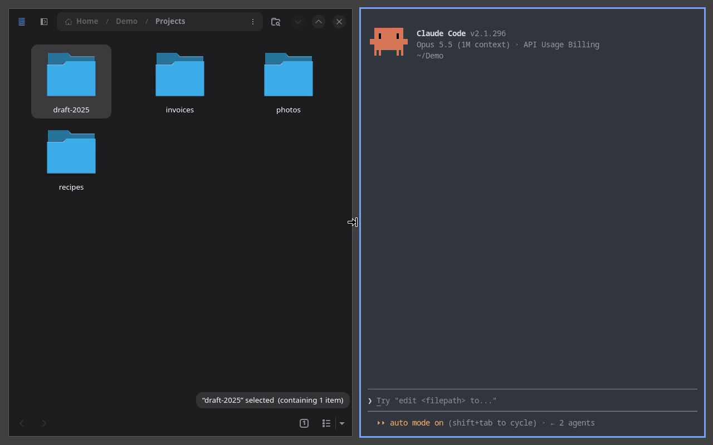

# Waldo

[](https://github.com/BFJ-Concerns/Waldo/actions/workflows/ci.yml)

Waldo lets a coding agent see and use the applications on your Niri Wayland
desktop. With Waldo installed, a Claude Code session can take screenshots of
your outputs and windows, read the focused application's accessibility tree,
and drive the pointer, keyboard, clipboard, windows and workspaces — then
check what actually happened before it carries on.



> [!WARNING]
> Waldo is in development and meant for supervised use on a machine you
> control. Its actions land on your live, foreground desktop, and the
> screenshots and on-screen text it collects are sent to the agent's model.
> Do not leave it running unattended or use it on a shared workstation.

## How it works

Waldo is a small controller with two clients:

- `waldod` is the controller. It runs as a systemd user service inside your
  Niri session and serves a private Unix socket.
- `waldo-mcp` is an MCP server that the Waldo plugin starts for the agent. It
  exposes four tools: `query`, `observe`, `act` and `stop`.
- `waldo` is a command-line client for the same protocol, for reproducing what
  an agent did and diagnosing problems.

The plugin also ships the `desktop-control` skill, which teaches the agent the
control loop: Query, Observe, one Act batch grounded on that observation,
inspect the receipts and the returned image, ground the next batch on a fresh
observation, and Stop when done.

Waldo talks to the desktop through Niri's IPC socket, the wlr screencopy,
virtual-pointer, virtual-keyboard and data-control Wayland protocols, and the
AT-SPI accessibility bus. Only one client drives at a time: the first to act
holds an exclusive driving lease until it stops, disconnects or goes idle.

### Design

- **Actions are grounded.** Every Act batch names the observation it was
  planned from, and before each action Waldo checks the live desktop
  against it. If the output geometry, the focused window or the target has
  changed, the action is refused rather than landing somewhere else.
- **Results are evidence, not assumptions.** A receipt says whether an
  action was dispatched, which is not the same as the application acting on
  it. After visual actions, Waldo returns a fresh observation from bounded
  sampling; `completion_evidence` says whether the application settled, so
  the agent checks what actually happened.
- **One protocol, two clients.** The CLI and the MCP server speak one
  versioned wire schema, which `waldo schema` prints. The tests decode
  every JSON example in the shipped skill against it, so the agent's
  instructions cannot drift from the code.
- **Tested from the outside in.** Beyond unit and live-session tests,
  `waldo-verification` drives the real binaries against disposable GTK, Qt
  and Electron applications and checks what each application received.

## Requirements

- A running [Niri](https://github.com/YaLTeR/niri) session managed by a
  systemd user manager (`systemctl --user` must work), which runs `waldod`.
- A Rust toolchain with Cargo (Rust 1.88 or later) and the libxkbcommon
  development headers.
- [Claude Code](https://docs.anthropic.com/en/docs/claude-code) 2.1.259 or
  later, installed as `claude` and logged in.
- Git, jq, realpath, rsync, sha256sum and systemctl on `PATH`.

The OpenAI Codex CLI is optional; see [Codex](docs/installation.md#codex).

## Installation

From a terminal inside your Niri session:

```sh
git clone https://github.com/BFJ-Concerns/Waldo.git
cd Waldo
./install-local
```

The installer builds and installs `waldod`, `waldo` and `waldo-mcp` with
`cargo install`, starts the `waldod` user service, and registers the Waldo
plugin with Claude Code. It then proves the installation with one real
headless Claude Code turn, which sends a screenshot of one of your outputs
to Claude, so clear anything sensitive from the screen first.

Run `./install-local` again to upgrade after pulling new changes.
[Installing Waldo](docs/installation.md) describes every step, rehearsal
installs into a disposable directory, and Codex support.

## Usage

Start Claude Code and ask for something that needs a desktop application, for
example:

```text
Open the Settings window and tell me which display scale is set.
```

The agent loads the desktop-control skill, queries the desktop, observes it,
acts in grounded batches, and calls Stop when it has finished. Your usual
Claude Code permission prompts apply to Waldo's tools.

To check the controller yourself, use the command-line client from Cargo's
bin directory (`~/.cargo/bin` by default):

```sh
waldo query --include-windows
```

[Using Waldo](docs/usage.md) is the reference for the four MCP tools, the
command-line client, image coordinates and what Waldo's results mean.

### Taking back control

Press Esc in Claude Code to interrupt the agent so that it plans no further
actions. When no batch is running, the agent's driving lease lapses 30
seconds after its last action (`WALDO_LEASE_IDLE_TIMEOUT_SECONDS`) and any
held keys or buttons are released.
A batch that is still running keeps its lease, and only the connection that
holds the lease can stop it, so another `waldo` invocation cannot. To end a
running batch, or everything at once, stop the controller:

```sh
systemctl --user stop waldod
```

It starts again with your next graphical session, or with
`systemctl --user start waldod`.

## Configuration

Waldo needs no configuration on a typical Niri desktop: it reads outputs,
scale, transforms and the keyboard layout from the running session. Settings
such as the controller socket, the lease idle timeout and the clipboard-paste
chord go in `${XDG_CONFIG_HOME:-$HOME/.config}/waldo/settings`.
[Configuration](docs/configuration.md) lists every setting, including the
installer's.

## Privacy and safety

- Screenshots, accessibility names and values, and clipboard contents that
  Waldo returns through MCP enter the agent's model conversation. Waldo has
  no redaction: anything visible on the observed output can be sent.
- Actions use the real pointer and keyboard on your foreground desktop. Stop
  cancels the current batch and releases held input; it does not close
  applications or undo earlier actions.
- The skill tells the agent to treat on-screen text, accessibility labels,
  clipboard contents and documents as untrusted evidence, never as
  instructions.
- The controller socket is private to your user, and the installation profile
  is written readable by you only.

## Limitations

- Niri is the only supported compositor so far (see [Roadmap](#roadmap)),
  and Claude Code the only fully supported agent; Codex support is
  best-effort.
- Waldo drives your live session in the foreground, with one driver at a
  time. It cannot create a nested, headless or private desktop, or send
  input to an application in the background.
- It is a supervised development tool for your own machine, not for
  unattended operation or a shared workstation, and there are no packaged
  releases yet.

[Scope and limits](docs/usage.md#scope-and-limits) has the details.

## Roadmap

Waldo is meant for the Linux desktop as a whole, not for one compositor.
Niri is where it starts, because no existing tool let a coding agent work on
a Niri desktop.

Most of what Waldo relies on is not specific to Niri. Screen capture,
virtual input and the clipboard use the wlr Wayland protocols, which other
compositors implement too, and accessibility goes through AT-SPI, which
works across desktops. Niri's IPC supplies the desktop model: outputs,
windows, workspaces and the keyboard layout.

## Development

```sh
cargo build --workspace
scripts/gate
```

`scripts/gate` runs the formatting, lint and test checks CI runs. Most tests
that need a live desktop pass without exercising anything outside a Niri session,
so run the gate inside one. [Development](docs/development.md) covers the
live tests and verification fixtures, and [`AGENTS.md`](AGENTS.md) the crate
layout. [Guidance for driving agents](docs/agent-guidance.md) lists what any
agent driving Waldo needs to be told.

## Reporting problems

Report bugs and other problems on the
[issue tracker](https://github.com/BFJ-Concerns/Waldo/issues). Include what
you or the agent attempted, what Waldo returned, and the output of
`waldo query`. That output includes your workspace names, so review it and
redact anything private before posting.

## Licence

Waldo is free software, licensed under the GNU Affero General Public
License, version 3 or (at your option) any later version
(`AGPL-3.0-or-later`). See [`LICENSE`](LICENSE) for the full text.
